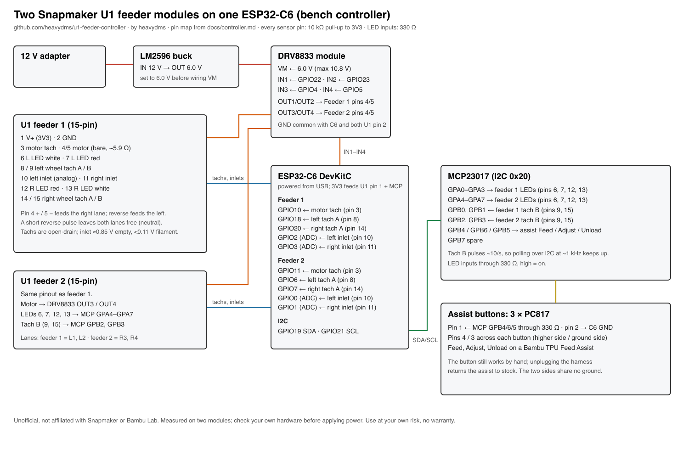
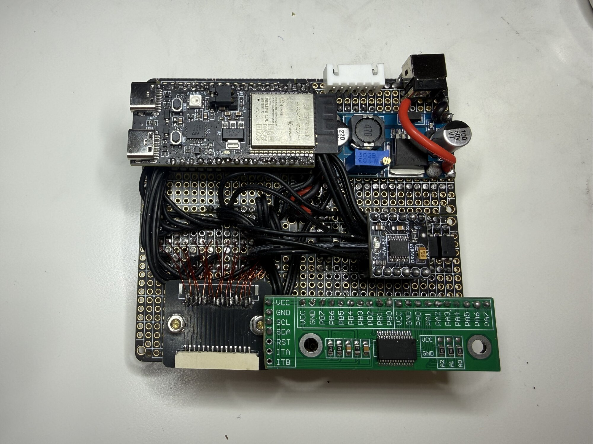
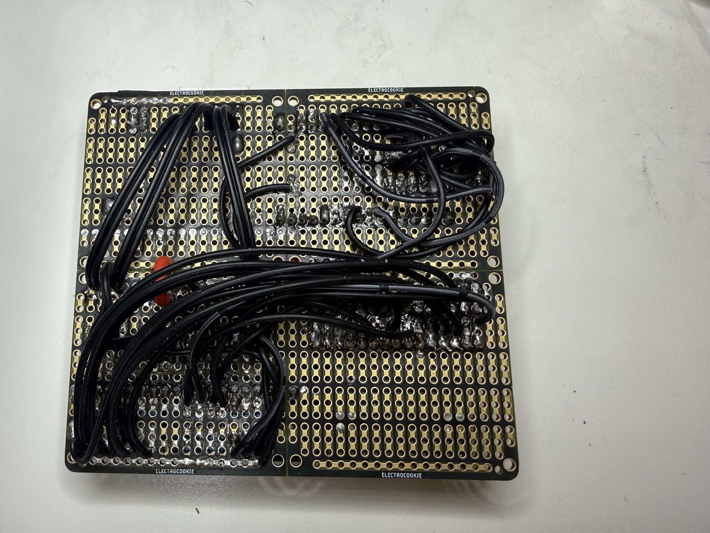

# u1-feeder-controller

Driving Snapmaker U1 filament feeder modules from an ESP32, outside the U1.

The goal is automatic 4-spool TPU switching for a Bambu Lab X2D:
- two U1 feeder modules (2 lanes each) push the spools into Bambu's 4-in-1 PTFE adapter;
- a stock Bambu TPU Feed Assist Module takes over from there;
- the ESP32 presses the assist's Feed, Adjust and Unload buttons through optocouplers.

Nothing inside the printer, the U1 modules or the assist is modified.

> **Update (November 2026): the two-U1 TPU route is set aside.** A U1 feeder pushes only: reversing its motor swaps
> lanes instead of pulling filament back, and its two lanes share one motor, so they can't feed at the same time.
> The project needs both, so it's moving to a different feeder. **The U1 pinout, electrical notes, controller and
> pin checker here still stand** and are kept as a reference for anyone driving a U1 feeder module.

```
Spool L1 ──┐               ┌── L1 ──┐
           ├─ U1 feeder 1 ─┤        │
Spool L2 ──┘               └── L2 ──┤
                                    ├──► Bambu 4-in-1 ──► TPU Feed Assist ──► X2D
Spool R3 ──┐               ┌── R3 ──┤                        ▲
           ├─ U1 feeder 2 ─┤        │                        │ Feed / Adjust / Unload
Spool R4 ──┘               └── R4 ──┘                        │ (PC817 optos)
                 ▲                                           │
                 └───────────── ESP32 controller ────────────┘
```

> **Disclaimer.** This is an independent hobby project. It is not affiliated with, endorsed by or supported by
> Snapmaker or Bambu Lab. Everything here is provided **as is, with no warranty of any kind**, and may be wrong
> or incomplete. The measurements come from a small number of modules and may not match yours. Wiring your own
> electronics to a printer, feeder or assist module can damage them, void their warranties, or cause a fire or
> injury. Check your own hardware before applying power. **You use any of this entirely at your own risk**, and
> the author accepts no liability for any damage or loss. See also the [LICENSE](LICENSE).

## The merge: Bambu's 4-in-1 PTFE Adapter II, not a homemade one

The four lanes join in a **genuine Bambu Lab 4-in-1 PTFE Adapter II**, the newer version with a filament cleaning
pad at its outlet. It's sold as an option on Bambu's
[4-in-1 PTFE Adapter page](https://us.store.bambulab.com/products/bambu-4-in-1-ptfe-adapter). Don't swap in a
printed or generic Y-splitter.

- **Made for filaments like this.** Bambu's product page says the 4-in-1 adapters are for feeding filaments the AMS
  can't handle, and names **TPU 95A** by name.
- **TPU is unforgiving.** It's soft and buckles at any gap, step or sharp angle in the path. A merge that works for
  PLA can jam or kink TPU.
- **Not the use Bambu documents.** Bambu's instructions put the adapter at the printer's inlet to combine an AMS
  with external spools, and list the Adapter II for H2, P1 and X1 printers. Here it merges four feeder lanes ahead
  of the TPU Feed Assist instead, so Bambu's printer compatibility list doesn't directly apply. You're using it
  outside Bambu's documented setup, at your own risk.
- **Fit it the right way round.** Bambu warns that reversing the IN and OUT ends can cause blockages.
- **Replace the cleaning pad when it wears.** Spares are sold separately.
- **Softer TPU:** Bambu names 95A. Softer grades (90A, 85A) aren't mentioned, so test them yourself first.

## Status (November 2026)

- **U1 feeder module: fully mapped.** All 15 connector pins, motor direction per lane, lane lock and neutral.
  See [docs/u1-feeder-electrical.md](docs/u1-feeder-electrical.md).
- **Controller bench rig: working.**
  - Both modules run on one ESP32-C6.
  - All 4 lanes feed, every inlet sensor and tach reads, and all 8 LEDs light.
  - See [docs/controller.md](docs/controller.md).
- **Next:**
  - testing the three assist button optos (wired);
  - the printer-side trigger (watching the X2D over local MQTT);
  - the mounting bracket;
  - real switching firmware.

## Docs

- [docs/u1-feeder-electrical.md](docs/u1-feeder-electrical.md): U1 feeder pinout, motor, sensors, LEDs, and how
  they were measured. Start here if you only want to drive a U1 feeder.
- [docs/controller.md](docs/controller.md): the ESP32-C6 controller, its parts, power, pin map and lane map.
- [firmware/pin_checker](firmware/pin_checker/pin_checker.ino): bench test sketch (Arduino, ESP32-C6).

## Photos



Bench controller (ESP32-C6, buck, DRV8833, MCP23017, U1 connector adapter, PC817s), top and wiring side:




## License

MIT, see [LICENSE](LICENSE).

## Sources

The U1 details come from measurements on real modules, plus Snapmaker's open-source
[u1-klipper](https://github.com/Snapmaker/u1-klipper) code.
